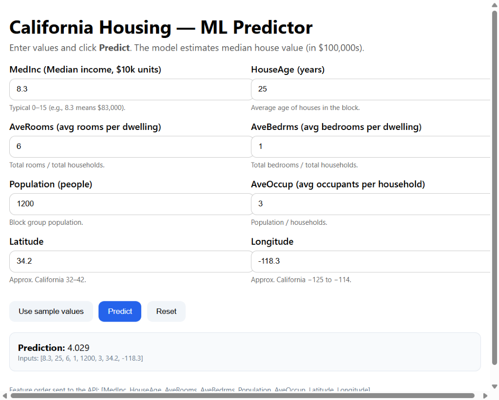

# California Housing — Model as a Service (Flask + Docker)

โปรเจกต์ให้บริการโมเดล Machine Learning (RandomForestRegressor บนชุดข้อมูล California Housing) ผ่านเว็บแอปพลิเคชัน Flask และบรรจุใน Docker Container สำหรับรายวิชา CPE312 Data Science

## โครงสร้างโปรเจกต์

```text
ml_service/
├─ app.py
├─ train_model.py
├─ requirements.txt
├─ Dockerfile
├─ .gitignore
├─ README.md
├─ templates/
│  └─ main.html
└─ model/           # ถูกสร้างอัตโนมัติเมื่อรัน train_model.py (ไม่ถูก commit ลง GitHub)
```

## วิธีการ Build และ Run ด้วย Docker

1. สร้าง Docker Image:

```powershell
docker build -t ds-ml-service .
```

2. รัน Docker Container:

```powershell
docker run --rm -p 5000:5000 ds-ml-service
```

> หากพอร์ต `5000` ถูกใช้งานอยู่ สามารถเปลี่ยนเป็นพอร์ตอื่นได้ เช่น `-p 8080:5000`

## การใช้งานและตรวจสอบผล

- **หน้าเว็บสำหรับทำนายผล:** http://127.0.0.1:5000/
- **ตรวจสอบสถานะ (Health Check):** http://127.0.0.1:5000/health
- **เรียก API `/predict` ด้วย PowerShell:**

```powershell
Invoke-RestMethod -Uri http://127.0.0.1:5000/predict -Method Post -ContentType "application/json" -Body '{"features":[8.3,25.0,6.0,1.0,1200,3.0,34.2,-118.3]}'
```

ตัวอย่างผลลัพธ์:

```json
{
  "prediction": 4.029
}
```

## การรันทดสอบแบบ Local (ไม่ใช้ Docker)

```powershell
python -m venv .venv
.\.venv\Scripts\Activate.ps1
pip install -r requirements.txt
python train_model.py
python app.py
```

## ตัวอย่างหน้าจอการใช้งาน


